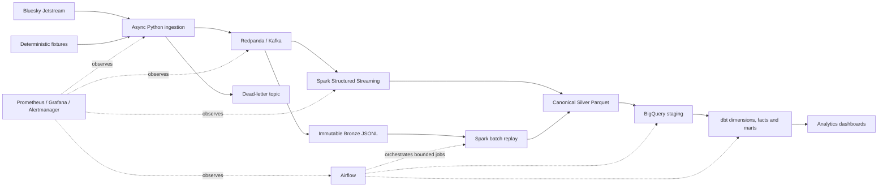

# BlueSkuPulse

**A production-style real-time data platform for the Bluesky / AT Protocol ecosystem.**

BlueSkuPulse continuously captures public Bluesky activity, preserves an immutable replayable
history, builds canonical analytical datasets, and produces warehouse marts for network activity,
topic velocity, link intelligence, creator growth, post engagement, conversation health, and
pipeline operations.

The project treats the data platform itself as the product: source recovery, durability,
idempotency, replay, schema evolution, deletes, data quality, orchestration, observability,
infrastructure, and measurable performance are implemented as first-class concerns.

## Architecture



### Data path

```text
Jetstream v1/v2
  → validated canonical event envelope
  → Kafka acknowledgement
  → durable source cursor
  → immutable partitioned Bronze
  → streaming or batch Spark normalization
  → deduplicated Silver Parquet
  → BigQuery
  → dbt facts, dimensions and analytics marts
```

## Engineering guarantees

- **At-least-once ingestion:** the source cursor advances only after Kafka acknowledges the event
  or its dead-letter record.
- **Safe recovery:** reconnects resume from a versioned, host-bound cursor; incompatible v1/v2
  cursors fail closed.
- **Deterministic identity:** stable source fields produce a SHA-256 event ID used throughout
  replay and deduplication.
- **Immutable Bronze:** compressed JSONL objects and commit manifests are create-only; Kafka
  offsets commit only after storage durability.
- **Canonical Silver:** Spark normalizes posts, likes, reposts, follows, identity/account events,
  updates, and deletes into versioned Parquet datasets.
- **Convergent replay:** streaming and historical batch processing reuse the same schemas and
  transformation functions.
- **Observable failures:** malformed input enters a DLQ with the original payload and reason;
  invalid Silver contracts enter quarantine.
- **Idempotent analytics:** BigQuery loads use deterministic batches and dbt incrementals use
  stable merge keys with a late-arrival lookback.

## Measured results

Measured on 2026-10-05 on an Apple-silicon MacBook Air using a two-vCPU Colima VM. Every result is
linked to a reproducible command, retained artifact, environment, and Git commit in
[the benchmark report](docs/benchmark.md).

| Workload | Events | Result |
|---|---:|---:|
| Sustained broker-acknowledged ingestion, 30 minutes | 1,800,000 | **999.989 events/s**, p95 acknowledgement 974.176ms, 0 errors |
| Five-minute burst | 1,500,000 | **4,999.613 events/s**, p95 acknowledgement 199.272ms, 0 errors |
| Unthrottled replay publish | 5,000,000 | **20,179.722 events/s**, p95 acknowledgement 48.661ms, 0 errors |
| Forced duplicate delivery | 1,000,000 including 100,000 duplicates | **0 duplicate canonical Silver rows** |
| Full retained replay | 9,320,000 deliveries | **5,000,000 distinct Silver IDs**, 0 duplicates, 0 quarantine |
| Bronze-to-Silver batch rebuild | 5,000,000 canonical events | **~319 seconds** |

### Live-source reliability

| Metric | Measured result |
|---|---:|
| Public Jetstream v2 observation window | 505,195 deliveries in 15.57 minutes |
| Ingestion-to-Bronze latency | p50 5.423s · **p95 10.190s** · p99 10.677s |
| Source-to-Bronze latency under observed backlog | p50 179.859s · p95 294.116s · p99 320.521s |
| Forced 30-second disconnect recovery | p50 31.804s · **p95 32.837s** |
| Detected socket failure to reconnect | p50 0.685s · p95 0.763s |
| Live raw duplicate rate | 0.002969% |
| Bronze compression | **5.497:1** |

### Correctness and quality

| Check | Measured result |
|---|---:|
| Live-date Bronze deliveries | 604,266 |
| Distinct Bronze event IDs | 604,243 |
| Canonical Silver event rows | 604,243 |
| Canonical duplicate rows | **0** |
| Quarantine rows | **0** |
| Bronze-to-Silver unexplained reconciliation delta | **0.000%** |
| Malformed-event injection | **100/100** malformed frames reached DLQ |
| Additive schema-drift injection | **10,000/10,000** accepted; 0 DLQ |
| dbt build | **28 models + 88 tests; 116/116 passing** |
| Python/Spark suite | **63 tests passing** |
| Core ingestion coverage | **85.93%** (CI gate: ≥80%) |
| Prometheus critical-alert detection | **17.605s** |
| Alertmanager receipt | **31.385s** |

## Analytics products

| Product | Questions answered |
|---|---|
| Network activity | How many posts, likes, reposts, follows, and active authors are observed each hour? |
| Topic velocity | Which hashtags are accelerating across 5m, 15m, and 1h windows? |
| Topic co-occurrence | Which hashtags appear together, and how much more often than chance (lift)? |
| Domain intelligence | Which external domains are shared most, rising fastest, and supported by unique sharers? |
| Creator activity | Which accounts are posting, gaining observed follow edges, and receiving engagement? |
| Post engagement | How many likes, reposts, replies, and quotes does each post receive? |
| Conversation health | What are reply depth, branching factor, participation, response time, and duration? |
| Pipeline health | Are freshness, duplicates, quarantine, and Bronze/Silver/Gold reconciliation healthy? |

Topic ranking includes a unique-author requirement and author-concentration guardrail so one
account cannot manufacture a trending score by repeatedly posting the same topic.

## Warehouse model

```text
Silver sources
├── silver_events
├── silver_posts
├── silver_engagements
├── silver_graph_edges
├── silver_identity
└── silver_quarantine
        │
        ▼
Staging views
        │
        ▼
Current-state intermediate models
        │
        ├── Dimensions: actor, date, hour, language, domain
        ├── Facts: posts, likes, reposts, follows, post engagement
        └── Marts: network, topics, topic pairs, domains, creators, engagement,
                   conversations, language activity, pipeline health
```

BigQuery incrementals use `MERGE`, date partitioning, workload-oriented clustering, additive
schema evolution, and a two-day lookback for late-arriving updates and deletes. DuckDB provides a
deterministic local warehouse target using the same dbt model graph.

## Quick start

Prerequisites: Docker, Python 3.12–3.14, `uv`, and Java 17.

```bash
git clone https://github.com/Aniruth1011/BlueSkuPulse.git
cd BlueSkuPulse
cp .env.example .env
make install
make up
make ingest-fixture
make bronze-once
```

This publishes deterministic v2-shaped fixtures to Redpanda and lands them in local immutable
Bronze storage. Redpanda Console is available at <http://localhost:8080>.

Build Silver from Bronze:

```bash
make spark-replay \
  BRONZE_PATH='data/bronze/bluesky/event_date=*/event_hour=*/collection=*/*.jsonl.gz' \
  OUTPUT_PATH='data/silver-rebuild/run-001'
```

Build and validate the local warehouse twice to exercise full and incremental behavior:

```bash
make dbt-deps
make dbt-seed
make dbt-build
make dbt-build
make dbt-docs
```

Start the complete local platform:

```bash
make up-pipeline
make up-orchestration AIRFLOW_DB_PASSWORD='<local password>'
make up-observability GRAFANA_ADMIN_PASSWORD='<local password>'
```

| Service | URL |
|---|---|
| Redpanda Console | <http://localhost:8080> |
| Airflow | <http://localhost:8081> |
| Grafana | <http://localhost:3000> |
| Prometheus | <http://localhost:9090> |
| Alertmanager | <http://localhost:9093> |

## Validation and benchmarks

Run the complete local validation suite:

```bash
./scripts/metrics/run.sh validate
```

Run the Kafka-backed benchmark profiles:

```bash
./scripts/metrics/run.sh full
```

Rebuild canonical Silver and execute controlled failure drills:

```bash
./scripts/metrics/run.sh replay-failures
```

Package benchmark evidence and stop services without deleting persistent volumes:

```bash
./scripts/metrics/run.sh archive-stop
```

The benchmark harness records parameters, event counts, elapsed time, throughput, p50/p95/p99
latency, CPU, memory, errors, duplicates, environment, measurement method, and Git SHA as JSON.

## Repository map

```text
ingestion/       Jetstream adapters, parsing, deterministic IDs, Kafka and cursor recovery
bronze/          Kafka consumer, immutable batching, manifests and storage abstraction
streaming/       Shared Spark transformations, Structured Streaming and batch replay
warehouse/       Idempotent BigQuery loading and warehouse metrics
dbt/             Staging, current state, dimensions, facts, marts, tests and lineage
airflow/dags/    Hourly pipeline, daily reconciliation and historical backfill
batch/           Bounded commands executed by Airflow
reliability/     Controlled service-outage scenarios
monitoring/      Prometheus, Alertmanager and Grafana configuration
infra/terraform/ GCS, BigQuery, IAM, secrets and monitoring infrastructure
benchmarking/    Reproducible throughput, latency and reconciliation measurement
tests/           Unit, contract, integration, reliability and load validation
docs/            Architecture, contracts, ADRs, runbook and benchmark evidence
```

## Key design decisions

- Kafka is the ingestion durability boundary; the source cursor never advances first.
- V1 timestamp cursors and v2 sequence cursors are isolated by adapter, kind, and host.
- Bronze is immutable and replayable; Silver is reproducible and canonical.
- Size-or-deadline batching controls both small-file pressure and landing latency.
- Spark transformations are shared by streaming and backfill paths.
- Deletes remain explicit mutations and fold into current state instead of disappearing.
- dbt owns analytical business logic, tests, documentation, and lineage.
- Airflow orchestrates bounded workflows and never owns the permanent WebSocket connection.
- Terraform owns durable cloud resources and least-privilege workload identities.

Detailed decisions are recorded in [the ADR directory](docs/adr/).

## Evidence

| Claim | Reproduction | Commit |
|---|---|---|
| 30-minute sustained and five-minute burst profiles | `./scripts/metrics/run.sh full` | `044a4461fe88105db69b3add1a55ca08b6fb8df7` |
| 5M canonical replay with zero duplicate Silver IDs | `./scripts/metrics/run.sh replay-failures` | `32b2684371e1e118ac10bc68c491026e42e3051d` |
| Independent Bronze-to-Silver rebuild and verification | `benchmarking.verify_silver` | `d4d41636905db68380f9720b7d5ad936827ad3b6` |
| Bounded live Jetstream latency and reconnect measurements | method and artifacts in `docs/benchmark.md` | `8c9d35c` |
| Live-date reconciliation, DLQ, schema drift, dbt and alerts | method and artifacts in `docs/benchmark.md` | `4c5c811` |

See [benchmark methodology and complete results](docs/benchmark.md),
[failure-injection evidence](docs/failure-testing.md), [architecture](docs/architecture.md),
[data contract](docs/data_contract.md), and the [operations runbook](docs/runbook.md).
