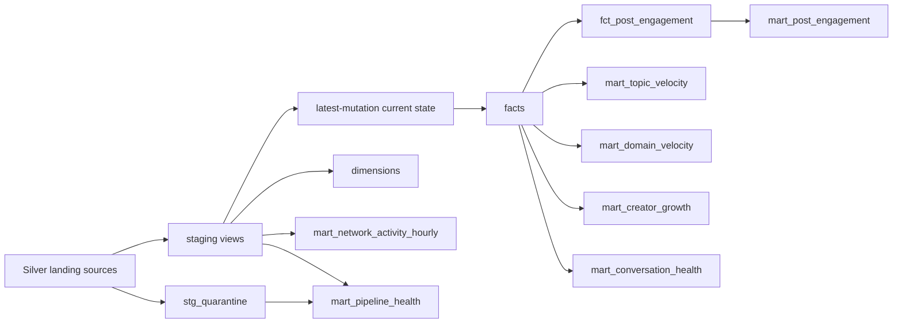

# Phase 5: BigQuery and dbt warehouse

## Purpose

Phase 5 turns canonical Silver mutations into a cost-aware analytical warehouse. BigQuery is the
production serving engine; dbt owns SQL transformations, tests, lineage, documentation, and model
grains. The phase never changes Bronze or Silver history.

```text
GCS Silver Parquet
       |
       v
deterministic BigQuery load table
       |
       v
event_id MERGE into partitioned/clustered Silver landing tables
       |
       v
dbt staging -> current state -> dimensions/facts -> marts
       |
       v
tests, reconciliation, freshness, docs, thin dashboard consumers
```

## BigQuery loading

Run one loader invocation per Silver dataset:

```bash
uv run python -m warehouse.loader events \
  'gs://<bucket>/silver/events/event_date=2026-10-04/*.parquet'
```

Supported dataset arguments are `events`, `posts`, `engagements`, `graph_edges`, `identity`, and
`quarantine`. The environment must provide `ATMOSPULSE_BQ_PROJECT`; Application Default
Credentials supply authentication. The GCS bucket and BigQuery datasets must share a compatible
location.

For every invocation the loader:

1. validates the dataset and GCS URIs;
2. hashes the dataset plus sorted URIs into a deterministic batch ID;
3. loads self-describing Parquet into a deterministic temporary table with `WRITE_TRUNCATE`;
4. creates the native target with date partitioning and clustering when it does not exist;
5. appends safe top-level additive fields to the destination schema;
6. deduplicates the temporary batch by `event_id`;
7. inserts only event IDs absent from the target using an atomic `MERGE`;
8. limits the target scan to the incoming date range;
9. logs rows presented and DML-affected rows;
10. deletes the temporary table.

Replaying the same URIs repeats the deterministic load and merge but inserts no duplicate event
identities.

## Physical layout

| Landing table | Partition | Clustering |
|---|---|---|
| `silver_events` | `event_date` | `collection`, `did`, `operation` |
| `silver_posts` | `event_date` | `author_did`, `at_uri`, `operation` |
| `silver_engagements` | `event_date` | `subject_uri`, `actor_did`, `engagement_type`, `operation` |
| `silver_graph_edges` | `event_date` | `actor_did`, `subject_did`, `operation` |
| `silver_identity` | `event_date` | `did`, `event_kind` |
| `silver_quarantine` | `event_date` | `event_kind`, `collection` |

Landing tables require a partition filter. This is a cost guardrail, not a claim of measured cost
reduction. BigQuery bytes scanned and runtime remain benchmark targets until Phase 10.

## dbt model graph



### Staging and current state

Staging views select explicit columns, cast timestamps and dates, split engagements into likes and
reposts, and retain one row per `event_id`. Posts, engagements, and follows are ranked within each
AT URI. The latest mutation becomes current state; a latest delete remains present with
`is_deleted=true`.

### Dimensions and facts

Dimensions cover actors, dates, hours, languages, and normalized external domains. Facts cover
posts, likes, reposts, follows, and post engagement. Facts expose stable, documented grains and
retain deletion state where applicable.

### Marts

All seven required marts exist:

- `mart_network_activity_hourly`
- `mart_topic_velocity`
- `mart_domain_velocity`
- `mart_creator_growth`
- `mart_post_engagement`
- `mart_conversation_health`
- `mart_pipeline_health`

Topic velocity uses five-minute windows, prior-window velocity and acceleration, unique-author
counts, and a largest-author concentration check. A topic with fewer than two authors or more than
50% of posts from one author receives a zero ranking score. This is a documented guardrail, not a
claim that the ranking is immune to coordinated manipulation.

## Tests and reconciliation

The dbt project contains generic and singular tests for unique/non-null grains, accepted values,
relationships, timestamp sanity, duplicate current state, Silver-to-staging reconciliation,
composite mart grains, daily reconciliation delta, and the topic spam safeguard.

`mart_pipeline_health` records distinct Silver events, modeled mutations, quarantine volume,
deletes, duplicate count, unexplained delta, and reconciliation ratio. Raw Bronze reconciliation
is added when the bounded reconciliation workflow is implemented in the Airflow phase.

## Local validation

DuckDB is used only as a deterministic local execution engine for dbt:

```bash
make dbt-deps
make dbt-seed
make dbt-build
make dbt-build
make dbt-docs
```

The repeated build validates incremental rerun behavior. Production selects the `bigquery` profile
using `ATMOSPULSE_DBT_TARGET=bigquery`.

## Logging and metrics

BigQuery loading emits structured JSON with batch ID, dataset, target, row count, and affected-row
count. Prometheus metrics expose `bq_rows_loaded_total`, `bq_load_duration_seconds`, and
`bq_load_failures_total`. dbt produces per-node timing, results, catalog, and lineage artifacts in
its `target` directory.

## What is not claimed

- No live GCP load was run without a supplied project and credentials.
- No bytes-scanned reduction or query latency has been measured.
- Local fixture runtimes are functional acceptance evidence, not performance benchmarks.
- Source freshness on static fixtures is not presented as a live freshness result.
